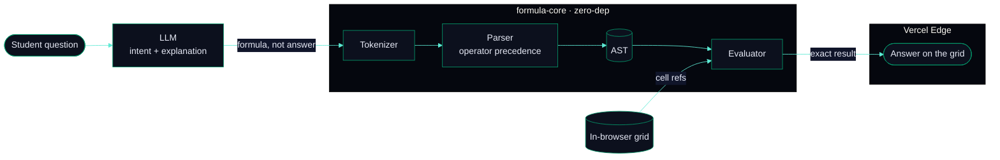

  
  
  
  

 

  
  

<b>⟢ Architecture: how Excel Masters keeps AI math deterministic</b> (click to expand)

 

<table width="100%">
  <thead>
    <tr><th align="left">System</th><th align="left">Class</th><th align="left">Uplink</th><th align="left">Activity</th></tr>
  </thead>
  <tbody>
    <tr>
      <td><a href="https://www.excelmasters.in/"><b>excelmasters.in</b></a></td>
      <td><code>web platform</code></td>
      <td></td>
      <td></td>
    </tr>
    <tr>
      <td><a href="https://github.com/ExcelMasters-in/formula-core"><b>formula-core</b></a></td>
      <td><code>open core</code></td>
      <td></td>
      <td></td>
    </tr>
    <tr>
      <td><a href="https://github.com/Kukzze/chic-bot-service"><b>chic-bot-service</b></a></td>
      <td><code>discord bot</code></td>
      <td></td>
      <td></td>
    </tr>
  </tbody>
</table>

<table width="100%">
  <tr>
    <td align="center" width="33%"><b>Frontend</b>  </td>
    <td align="center" width="33%"><b>Backend & Data</b>  </td>
    <td align="center" width="33%"><b>Infrastructure</b>  </td>
  </tr>
</table>

<picture>
  <source media="(prefers-color-scheme: dark)" srcset="https://raw.githubusercontent.com/prosteeler/prosteeler/output/github-contribution-grid-snake-dark.svg" />
  <source media="(prefers-color-scheme: light)" srcset="https://raw.githubusercontent.com/prosteeler/prosteeler/output/github-contribution-grid-snake.svg" />
  
</picture>

